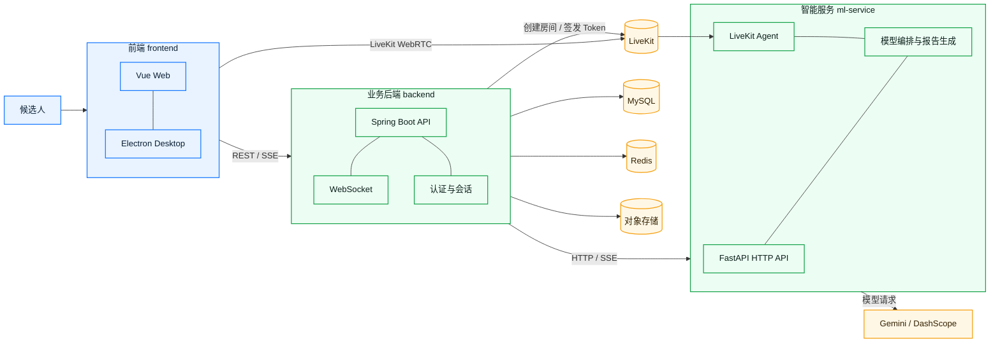

# 伯乐智面 · Bole AI Interview

> AI 多模态模拟面试系统：准备、对练、复盘、迭代，一站式完成面试训练。


## 产品概览

伯乐智面把岗位信息、简历、实时面试和结构化复盘连接成完整闭环，支持：

- 文本、语音、视频三种面试模式；
- LiveKit WebRTC 实时音视频和自然打断；
- AI 面试官与可选数字人；
- 简历上传、解析和岗位上下文注入；
- 面试结束后生成能力雷达、维度评分和改进建议；
- Web 与 Electron 双端运行。

## 项目完整展示

以下视频完整展示伯乐智面的产品流程与核心能力，包括项目首页、面试创建、文本/语音/视频面试、实时 AI 面试官交互以及面试报告复盘。

https://github.com/user-attachments/assets/bd54436e-55e8-4f8f-b933-7b2a039f9ed6

## 系统架构



### 模块职责

| 模块 | 技术栈 | 职责 |
| --- | --- | --- |
| [`frontend`](./frontend) | Vue 3、Vite、Electron、LiveKit Client | 页面、采集、WebRTC 订阅、报告展现 |
| [`backend`](./backend) | Spring Boot、MySQL、Redis、WebSocket | 用户、面试会话、文件、LiveKit Token、业务编排 |
| [`ml-service`](./ml-service) | Python、FastAPI、LiveKit Agents、Gemini、DashScope | 实时 Agent、追问、分析和报告生成 |

## 快速开始

### 1. 前端

```bash
cd frontend
npm install
npm run dev
```

Node.js 需要满足 Vite 7 的要求，推荐 Node.js 22 LTS。生产构建：

```bash
npm run build       # Web
npm run dist:win    # Windows Electron 安装包
```

### 2. 后端

```bash
cd backend
./mvnw clean package -DskipTests
./mvnw spring-boot:run
```

后端运行前请通过环境变量配置数据库、Redis、邮件、对象存储、LiveKit 和模型服务凭证。不要把真实配置写入 `application.yaml` 或源码。

### 3. ML Service

```bash
cd ml-service
cp .env.example .env.ml-service
# 编辑 .env.ml-service，填入本地凭证
docker compose -f docker-compose.dual.yml up -d --build
curl http://127.0.0.1:8000/health
```

详细配置和 API 说明见 [`ml-service/README.md`](./ml-service/README.md)。

## 主要链路

1. 用户在前端创建面试，提交岗位、难度、风格和面试模式。
2. 后端创建会话并签发 LiveKit Token，或转发文本模式请求。
3. 前端通过 REST/SSE 与后端交互，通过 LiveKit 订阅实时音视频。
4. ML Service 根据简历、JD 和对话上下文生成问题、追问与评价。
5. 面试结束后生成报告，后端保存结果，前端展示并支持导出。

## 目录结构

```text
.
├── frontend/       # Vue / Electron 客户端
├── backend/        # Spring Boot 服务
├── ml-service/     # FastAPI 与 LiveKit Agent
├── .github/        # CI/CD
└── README.md
```

## 安全与协作

- 使用 Secret Manager、GitHub Actions Secrets 或部署平台环境变量管理密钥。
- `.env.ml-service`、数据库密码、LiveKit Secret 和模型 API Key 禁止提交。
- 发现泄露时立即吊销并重新生成凭证，同时清理 Git 历史。
- 通过功能分支和 Pull Request 合并，不直接在 `main` 上开发。

## 相关文档

- [前端 README](./frontend/README.md)
- [ML Service README](./ml-service/README.md)
- [LiveKit Realtime models](https://docs.livekit.io/agents/models/realtime/)
- [LiveKit Gemini Live API](https://docs.livekit.io/agents/models/realtime/gemini/)

## License

本项目遵循仓库中的 [LICENSE](./LICENSE)。
