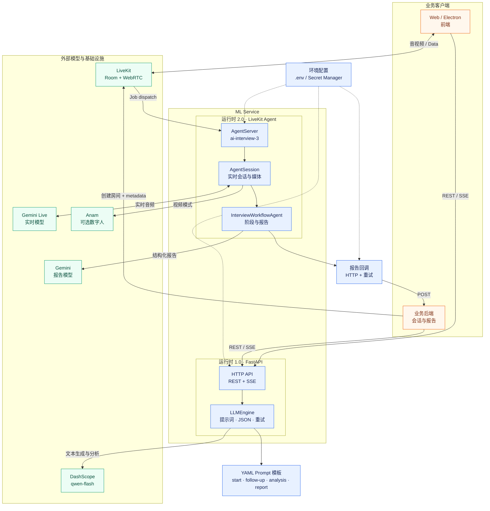

# ML Service

实时 AI 面试服务，包含两个相互独立的运行时：

- **1.0 HTTP API**：FastAPI 提供面试启动、追问、分析和报告接口。
- **2.0 LiveKit Agent**：LiveKit Worker 负责实时音频会话、Gemini Live 对话和可选的 Anam 数字人。

> 文档基于当前仓库代码和 LiveKit Agents 1.8.5 编写。模型、插件和云服务会持续变更；生产部署前请再次核对供应商的模型状态与配额。

## 目录

- [架构](#架构)
- [运行要求](#运行要求)
- [快速开始](#快速开始)
- [配置](#配置)
- [启动方式](#启动方式)
- [HTTP API](#http-api)
- [LiveKit Agent](#livekit-agent)
- [生产部署建议](#生产部署建议)
- [故障排查](#故障排查)

## 架构



### 数据流与边界

1. **HTTP 面**：前端或业务后端调用 FastAPI；`LLMEngine` 从 YAML 模板构造提示词，通过 DashScope 的 OpenAI-compatible API 完成首问、追问、回答分析和报告生成。流式接口通过 SSE 返回增量字段。
2. **实时面**：业务后端创建或调度 LiveKit Room，并把面试配置写入 job、context 或 room metadata；Agent Worker 接收任务后创建 `AgentSession`，从 Gemini Live 获取实时对话能力。
3. **媒体面**：浏览器/Electron 与 LiveKit Room 交换音视频轨道。视频模式且配置了 Anam 凭证时，Agent 额外启动 AvatarSession；缺少配置时继续运行但不输出数字人。
4. **报告面**：2.0 Agent 从会话上下文和 transcript 渲染报告提示词，使用 Google Gemini 生成结构化报告，经过分数归一化后通过 HTTP 回调业务后端。
5. **部署边界**：1.0 API 与 2.0 Agent 使用独立依赖、Dockerfile 和进程，可分别部署、扩缩容和进行故障隔离。

## 运行要求

- Python 3.11
- Docker 24+ 与 Docker Compose v2（容器部署）
- LiveKit Cloud 项目，或自建 LiveKit Server
- 1.0：DashScope API Key
- 2.0：Google Gemini API Key，或 Vertex AI 身份认证
- 视频模式：Anam API Key 与 Avatar ID

## 快速开始

```bash
cd ml-service
cp .env.example .env.ml-service
# 编辑 .env.ml-service，填入本地或部署环境的真实凭证
```

不要提交 `.env.ml-service`，不要把 Key 写入源代码、README、日志或 Docker 镜像。仓库中的 `.env.example` 只允许包含空值或示例值。

### 本地安装

```bash
python3.11 -m venv .venv
source .venv/bin/activate
python -m pip install --upgrade pip
python -m pip install -r app/requirements.txt
python -m pip install -r app/requirements.agent2.txt
```

### Docker Compose

```bash
docker compose -f docker-compose.dual.yml up -d --build
docker compose -f docker-compose.dual.yml ps
curl http://127.0.0.1:8000/health
```

## 配置

配置文件默认是 `ml-service/.env.ml-service`，也可以通过 `ML_SERVICE_ENV_FILE` 指定其他路径。

### 必填配置

| 变量 | 用途 |
| --- | --- |
| `DASHSCOPE_API_KEY` | 1.0 文本模型鉴权 |
| `GOOGLE_API_KEY` | Gemini API 鉴权；使用 Vertex AI 时可不填 |
| `LIVEKIT_URL` | LiveKit WebSocket 地址 |
| `LIVEKIT_API_KEY` | LiveKit Agent 鉴权 |
| `LIVEKIT_API_SECRET` | LiveKit Agent 鉴权 |

### 模型配置

| 变量 | 当前默认值 | 说明 |
| --- | --- | --- |
| `JUDGE_MODEL` | `qwen-flash` | 1.0 面试分析模型 |
| `GEMINI_MODEL` | `gemini-3.8-live` | 2.0 Gemini Live 实时模型 |
| `REPORT_MODEL` | `gemini-3.8-flash` | 2.0 报告生成模型 |
| `GEMINI_VOICE` | `Puck` | Gemini Live 音色 |
| `GOOGLE_USE_VERTEXAI` | `false` | 是否使用 Vertex AI |
| `GOOGLE_CLOUD_PROJECT` | 空 | Vertex AI 项目 |
| `GOOGLE_CLOUD_LOCATION` | 空 | Vertex AI 区域 |

`gemini-3.8-live` 是 LiveKit 当前文档列出的 Gemini Live 模型。此项目使用 Google plugin 直连 Google API/Vertex AI，而不是 LiveKit Inference；因此仍需配置 Google 凭证。若改用 LiveKit Inference，需要改造 `app/agent.py` 的模型构造方式，并使用 LiveKit 凭证承担推理计费。

### 可选配置

| 变量 | 用途 |
| --- | --- |
| `ANAM_API_KEY` | Anam 数字人鉴权 |
| `ANAM_API_URL` | Anam API 地址 |
| `ANAM_AVATAR_ID` | Anam Avatar ID |
| `ANAM_AVATAR_NAME` | Avatar 名称 |
| `REPORT_CALLBACK_URL_TEMPLATE` | 报告完成回调地址，必须包含 `{interviewId}` |
| `INTERVIEW_MODE` | `text`、`audio` 或 `video` |
| `LOG_LEVEL` | 日志级别，默认 `INFO` |

## 启动方式

### 仅启动 HTTP API

```bash
cd ml-service
source .venv/bin/activate
uvicorn app.main:app --host 0.0.0.0 --port 8000
```

### 仅启动 LiveKit Agent

```bash
cd ml-service
source .venv/bin/activate
python -m app.agent start
```

LiveKit Agent 需要先在 LiveKit 房间中注册任务，并通过房间 metadata 提供面试配置。metadata 的 JSON 结构可参考 `ROOM_METADATA_TEMPLATE_JSON`。

## HTTP API

| 方法 | 路径 | 用途 |
| --- | --- | --- |
| `GET` | `/health` | 健康检查 |
| `POST` | `/api/v1/interview/start` | 启动面试 |
| `POST` | `/api/v1/interview/start/stream` | 流式启动面试 |
| `POST` | `/api/v1/interview/followup` | 生成追问 |
| `POST` | `/api/v1/interview/followup/stream` | 流式生成追问 |
| `POST` | `/api/v1/interview/analysis` | 分析回答 |
| `POST` | `/api/v1/interview/report` | 生成并回调报告 |

请求和响应模型定义在 `app/schemas/schemas.py`。部署后可通过 FastAPI 文档查看实际 schema：

- Swagger UI：`http://127.0.0.1:8000/docs`
- OpenAPI JSON：`http://127.0.0.1:8000/openapi.json`

## LiveKit Agent

2.0 使用 `livekit-agents==1.8.5` 和 `livekit-plugins-google==1.8.5`。默认实时模型为 `gemini-3.8-live`；该模型要求 Google plugin 至少 1.8.5，尤其是 Vertex AI 场景。

实时会话支持：

- Gemini Live 音频输入与音频输出
- 会话续接和上下文窗口压缩
- 自动语音活动检测
- `text`、`audio`、`video` 模式
- 可选 Anam 数字人视频输出

视频模式缺少 `ANAM_API_KEY` 或 `ANAM_AVATAR_ID` 时，Agent 会记录告警并继续运行，但不会创建数字人。

## 生产部署建议

1. 使用 Secret Manager、CI/CD Secret 或云平台 Secret 注入凭证，不使用提交到仓库的 env 文件。
2. 为 1.0 API 与 2.0 Agent 使用独立运行身份、独立 Key 和最小权限。
3. 锁定依赖版本，定期在 staging 环境升级 LiveKit Agents，并验证 realtime model、工具调用和报告生成。
4. 只暴露反向代理端口；不要把 LiveKit API Secret、Google Key 或回调鉴权信息写入日志。
5. 为 `/health`、模型请求、回调请求设置超时、重试和监控告警。
6. 对报告回调实现幂等，避免网络重试造成重复写入。
7. 变更模型前先检查官方模型生命周期、区域可用性、配额和价格。

## 故障排查

### `DASHSCOPE_API_KEY 未配置`

确认 `.env.ml-service` 存在、变量非空，并从 `ml-service` 目录启动 API。使用 Docker Compose 时确认 `env_file` 指向该文件。

### `GOOGLE_API_KEY 未配置`

非 Vertex AI 模式必须设置 `GOOGLE_API_KEY`。Vertex AI 模式需要设置 `GOOGLE_USE_VERTEXAI=true`、`GOOGLE_CLOUD_PROJECT` 和 `GOOGLE_CLOUD_LOCATION`，并确保运行身份有权限。

### Gemini Live 连接失败

检查 `GEMINI_MODEL` 是否为当前区域和凭证可用的模型，确认 `livekit-plugins-google` 与 `livekit-agents` 版本一致，并检查 Google API 配额及网络出口。

### Agent 没有加入房间

确认 `LIVEKIT_URL`、`LIVEKIT_API_KEY`、`LIVEKIT_API_SECRET` 匹配同一个 LiveKit 项目，并确认 Agent 进程日志中已成功注册。

## 相关文档

- [LiveKit Realtime models](https://docs.livekit.io/agents/models/realtime/)
- [LiveKit Gemini Live API](https://docs.livekit.io/agents/models/realtime/gemini/)
- [LiveKit Gemini LLM](https://docs.livekit.io/agents/models/llm/gemini/)
- [LiveKit Agents Python reference](https://docs.livekit.io/reference/python/)
